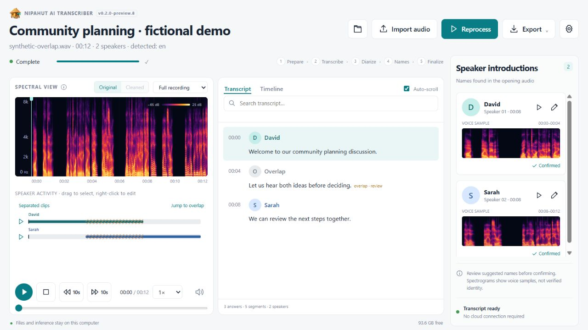
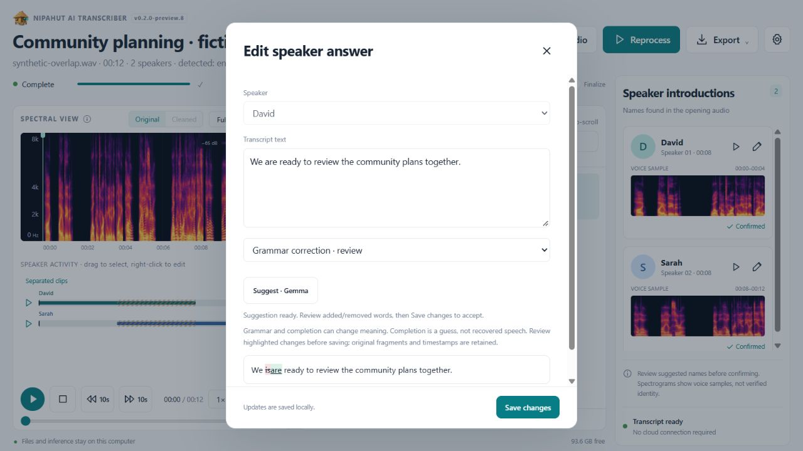

<p align="center"></p>

<h1 align="center">Nipahut AI Transcriber</h1>
<p align="center"><strong>Your conversations. Your computer.</strong><br>Local transcription, speaker diarization, and a workspace for careful human review.</p>
<p align="center">Windows desktop · Multilingual · Offline inference · MIT application source</p>

<p align="center">
  <a href="LICENSE"></a>
  
  
  <a href="https://github.com/DaleJohn-Dev/Nipahut-AI-Transcriber/releases"></a>
  
</p>

<p align="center"><a href="#built-for-reviewing-real-conversations">Features</a> · <a href="#install-the-development-package">Quickstart</a> · <a href="#choose-the-models-you-need">Models</a> · <a href="docs/PRIVACY.md">Privacy</a> · <a href="CONTRIBUTING.md">Contributing</a> · <a href="CHANGELOG.md">Changelog</a> · <a href="https://github.com/DaleJohn-Dev/Nipahut-AI-Transcriber/releases">Releases</a></p>

Turn meetings, interviews, and focus-group recordings into readable, speaker-labelled transcripts—without sending audio to a cloud transcription service. See where each person speaks, check their introduction, listen to detected speaker turns, and export a transcript you can work with.

> **Development preview.** Transcripts and speaker identities need review. The app does not promise error-free transcription, verified identity, or ten-way voice separation.

**Current development version: [VERSION](VERSION).** Read grouped speaker answers beside the spectrogram, follow playback with Auto-scroll, and review optional local Gemma punctuation, grammar and completion suggestions before accepting them. Experimental two-voice overlap previews remain available. See the [complete update history](CHANGELOG.md).



*Current application interface with fictional participants and locally synthesized demonstration audio. The displayed transcript is an authored UI fixture, not an accuracy benchmark. No private recording is shown.*



*Optional local writing assistance: inspect added and removed words, then explicitly save or discard. Sentence completion is speculative, not recovered speech. This example uses authored text.*

## Built for reviewing real conversations

| Feature | What you can do |
| --- | --- |
| Local transcription | Multilingual Whisper through faster-whisper/CTranslate2 with CPU INT8 compute. |
| Speaker activity | Aligned lanes, simultaneous intervals, timestamps and uncertain assignments. |
| Introduction names | Suggest names from opening self-introductions, then confirm or correct them. |
| Voice references | Anchor labels with clean reference clips and optionally cross-check uncertain clean regions with a second embedding model. |
| Spectral inspection | Inspect time, frequency and signal strength in the recording and speaker samples. |
| Playback | Play/pause, stop, skip ±10 seconds, 1×–2× speed, and review a speaker's detected turns, including overlapping speech. |
| Targeted edits | Select a lane range and right-click to silence or restore detected solo activity while retaining the original. |
| Experimental overlap review | Separate a short detected two-voice overlap, compare both sources with the original, and manually assign speakers before lane playback. |
| Transcript review | Read grouped same-speaker answers, follow playback with Auto-scroll, search, edit text and correct assignments. |
| Optional Gemma writing assistance | Review punctuation, grammar or short speculative completions with highlighted changes and preserved source text. |
| Useful exports | Plain PDF, TXT, SRT subtitles, JSON and RTTM speaker activity. |
| Compact workspace | Overlay settings, light/dark themes, model load/unload and a slim processing status row. |

Optional denoise, dehiss, hum filtering and normalization are available. Cleaning can also remove useful speech cues, so compare the original before relying on it for difficult audio.

## Install the development package

Requires **Windows x64**, **Python 3.12**, and Git. Internet access is needed to install dependencies and download models; installed inference runs offline. Node.js is optional for JavaScript development checks.

```powershell
git clone https://github.com/DaleJohn-Dev/Nipahut-AI-Transcriber.git
cd Nipahut-AI-Transcriber
.\setup.ps1 -Desktop -DownloadModels
& ".\Start Nipahut AI Transcriber.cmd"
```

This installs the desktop dependencies and downloads Whisper small, shared segmentation/WeSpeaker, CAM++ and the independent ERes2Net verifier. In Settings, select **CAM++** for speaker diarization and enable or disable the independent check as needed. Existing model folders are reused.

Whisper and optional Qwen weights download directly from **Hugging Face**. Speaker models and native runtimes use their **official upstream releases**. Weights are not committed to Git or copied into a second Hugging Face cache. No Hugging Face token or hosted inference account is required for the configured public downloads.

### Choose the models you need

```powershell
# Smaller transcription model for constrained computers
.\setup.ps1 -Desktop -DownloadModels -AsrModel whisper-base

# Larger Whisper model; more disk/RAM and potentially longer CPU processing
.\setup.ps1 -Desktop -DownloadModels -AsrModel whisper-turbo

# Optional local text model for introduction-name analysis
.\setup.ps1 -Desktop -DownloadModels -IncludeNameModel

# Optional experimental overlap separator (about 106 MB; CPU ONNX)
.\setup.ps1 -Desktop -DownloadModels -IncludeSeparationModel

# Preview sources and approximate sizes without downloading
.\.venv\Scripts\python.exe scripts/download_models.py --plan
```

| Download | Approximate local model space | Purpose |
| --- | --- | --- |
| Whisper base / small / turbo | 150 MB / 490 MB / 1.65 GB | Choose one ASR model to start. |
| Shared diarization + CAM++ + ERes2Net | 140 MB | Segmentation, voice embeddings and an independent check. |
| Optional Qwen3 0.6B + llama.cpp | 680 MB | Text analysis of introductions; not an audio ASR model. |
| Optional SepFormer WHAMR FP32 ONNX | 108 MB | Experimental two-source previews, downloaded only when requested. |

Python/Qt dependencies and recordings need additional space. Downloads reserve at least 3 GB of free space. Settings shows model sizes and free disk space; unused models can be removed there. Exact sizes depend on the upstream artifact.

## From recording to reviewed transcript

1. Import or drop audio. AAC, WAV, MP3, M4A, FLAC, OGG, OPUS, MP4, WEBM and WMA are accepted subject to the installed PyAV codecs.
2. Choose language, models and participant count in Settings. Let participants introduce themselves individually near the start when possible.
3. Transcribe. Follow preparation, optional cleanup, transcription, diarization and name analysis in the progress row.
4. Review names, uncertain turns and overlaps. Voice samples and timestamps provide evidence to check—not proof of identity.
5. Correct labels or text, then export PDF, TXT, SRT, JSON or RTTM.

The per-recording count supports auto detection or 1–20 participants. Original uploads and decoded audio are retained. Reprocessing archives the previous result; speaker-only updates reuse cached word timestamps when available.

## Languages and practical limits

English and Filipino/Tagalog use Whisper's supported language modes. **Taglish** uses automatic detection plus a Filipino/English hint. **Cebuano/Bisaya and Bicolano/Bikol are experimental**, with hints rather than dedicated Whisper language tokens. Names, regional speech, distant microphones and code switching need human review.

The current segmentation model detects at most **two simultaneous voices**. A meeting may contain ten participants, but that does not mean the app can separate ten people speaking at once. Lanes retain simultaneous intervals; mixed words are marked for review instead of copied into invented individual transcripts.

Speaker-lane playback includes overlapping sections using the original mix, so other voices may be audible. In v0.2, manually confirmed short separated clips replace the mix in the assigned lanes when available; missing previews fall back to the mix. Extraction is imperfect: leakage, missing speech, distortion and wrong labels remain possible. Speaker-only silencing in the original overlapping mixture remains blocked; review previews do not edit that mix.

### Experimental overlap review

1. Download **SepFormer WHAMR FP32** in Settings → Models, or use `-IncludeSeparationModel` during setup. It is optional and is not part of ordinary transcription.
2. Drag a **0.5–20 second** selection over detected overlapping activity in a speaker lane. Right-click → **Separate two voices · experimental**. The selection must contain overlap and at most two speaker labels; shorten it if several people take turns inside the selection.
3. Listen to the original and estimated Source A / B. Leave the clip unassigned or remove it if it does not sound better. Source labels have no automatic identity meaning.
4. Assign two different speakers and confirm only after listening. Their lane players can then use those clips while keeping the original mix muted for the selected overlapping interval. Unconfirmed outputs are never routed into speaker lanes.

The source is the Apache-2.0 [SpeechBrain WHAMR16k model](https://huggingface.co/speechbrain/sepformer-whamr16k), distributed here through a [community FP32 ONNX conversion](https://huggingface.co/tonythethompson/SepFormer-WhamR16k-ONNX), pinned by revision and SHA-256. This is not an official SpeechBrain ONNX release. English synthetic testing improved one source but did **not** improve both sources, so automatic replacement is not justified. Filipino/Taglish accuracy has not been established. The earlier INT8 candidate was not shipped.

Only selected clips are processed; no whole-recording stems are generated. At most 50 clips are kept per recording (about 1.3 MB per 20-second two-source PCM preview). Repeated requests reuse matching previews. Audio edits or diarization reruns clear confirmations; stale previews cannot be used until regenerated or reviewed as appropriate. “Separated clips” opens the saved review list.

Spectrograms visualize sound; they are not unique biometric fingerprints. Embeddings help match voices within a recording and do not provide verified identity or voice authentication. No full-recording minimal error rate is claimed without a human-labelled reference.

## Open source, attribution and privacy

The application's original source is [MIT licensed](LICENSE). Third-party software and weights retain their own licenses, including MIT, Apache-2.0, BSD and LGPL/GPL terms. See [THIRD_PARTY_NOTICES.md](THIRD_PARTY_NOTICES.md), the full texts in [third-party/](third-party/), and its generated dependency inventory. The app's license does not replace those obligations.

Recordings, transcripts, voice references, personal settings, local reports, credentials and build output are excluded from this repository. Installation makes normal requests to upstream download servers; transcription and speaker inference use local files. Read [the privacy and publication boundaries](docs/PRIVACY.md).

## Develop and build

```powershell
.\.venv\Scripts\python.exe -m pip install --no-cache-dir -r requirements-dev.txt
.\.venv\Scripts\python.exe -m pytest -q
node --check static/app.js
node --check static/clip-controls.js
node tests/player_controls.test.cjs

# Build the Windows desktop folder bundle
.\scripts\build_desktop.ps1
```

Close the app and use `-UpdateExisting` to replace an existing build while retaining a rollback. The portable package needs **Nipahut AI Transcriber.exe**, **_internal/** and its adjacent **models/** and **data/** folders. The source repository does not contain a prebuilt EXE.

The native Qt window embeds the single-page interface and a loopback-only FastAPI engine. Native speaker inference runs in a separate process to keep the parent responsive. A local text-only Qwen service is optional. PyTorch and CUDA are not required by the configured ONNX/CTranslate2 stack.

| Directory | Responsibility |
| --- | --- |
| `app/` | Audio, ASR, diarization, references, exports, storage and local API. |
| `static/` | Interface, player, spectrogram controls and branding. |
| `desktop.py` | Native window, engine lifecycle and file dialogs. |
| `scripts/` | Setup, downloads, packaging, synthetic demos and developer checks. |
| `tests/` | Synthetic/unit fixtures; no user recordings. |
| `third-party/` | Attribution and retained upstream license texts. |

To refresh notices, run `scripts/license_inventory.py` and `scripts/retain_model_notices.py`. Before publishing, stage reviewed source and run `scripts/audit_public_files.py`.

Contributions are welcome: clear reproductions, privacy-safe synthetic fixtures, measured speaker-error reductions and improvements for Filipino and regional-language speech are especially useful. Never attach someone else's private recording or voice reference to a public issue.

See [CONTRIBUTING.md](CONTRIBUTING.md) for the development workflow and evidence expected for accuracy changes.

### Readable answers and playback follow

Consecutive fragments from the same identified speaker are displayed as one answer. Grouping stops at another speaker, overlapping speech, a pause longer than 1.5 seconds, or a 90-second answer limit. It joins existing words without inventing missing speech. Click an original fragment within an unedited answer to seek its original time; double-click the answer to edit. Grouped edits are stored separately from the original fragments. Changing the underlying transcript invalidates stale answer edits. Plain TXT/PDF exports use the grouped answers; SRT keeps the original timed segments, and JSON retains the underlying transcript and answer edits.

**Auto-scroll** beside Transcript/Timeline follows the active answer during playback and remembers your choice on this computer. Turn it off to read elsewhere while audio plays. The spectrogram continues to follow playback within the selected zoom range.

**Optional Gemma:** Settings → Models → Answer readability offers Gemma 4 E2B Q4_0 text inference through the existing llama.cpp CPU runtime. The weights are approximately 2.84 GB (decimal); download is opt-in and existing Whisper, Qwen and speaker models remain available. Runtime and license files are downloaded locally too. Model revision `6938c58e698502037401a5f19f6905f2fb2f7dee` and llama.cpp `b9000` are pinned, with SHA-256 verification. No audio projector is downloaded: this integration offers writing suggestions for recognized text, not Gemma audio transcription. In the answer editor choose a writing mode and **Suggest · Gemma**, review the result, then save to accept. Punctuation-only suggestions that change the recognized word sequence are rejected. Grammar correction and speculative sentence completion are separate opt-in modes: added and removed text is highlighted, Discard restores the editor input, and Save changes is required to accept. Completion can append at most 20 words while retaining the recognized word sequence; it is a guess, not recovered audio. Accepted AI edits are tagged as reviewed and retain original text. Grammar/completion labels are also included in transcript exports so speculative additions are distinguishable from verbatim speech. This cannot recover misheard words, guarantee grammatical sentences from incomplete speech, or establish Filipino/Taglish accuracy. CPU generation speed has not been benchmarked on this computer; no model is downloaded automatically.

A checksum-verified existing local Gemma variant can also be reused by a supported installation. This machine reuses the official Google Gemma 4 E4B QAT Q4_0 copy (approximately 5.15 GB), with the model card and Apache-2.0 license retained. Its source copy remains untouched. The default downloadable model remains E2B Q4_0. A small two-bit E2B candidate was tested but introduced a grammar fragment; it was not retained as the selected copy. Short fictional grammar/completion checks on E4B took about 7.4/8.4 seconds for generation after model startup; these are smoke tests, not language-accuracy benchmarks. No local model weights or source-folder paths are published.

### Version tracking

[VERSION](VERSION) drives the desktop and UI badge. [CHANGELOG.md](CHANGELOG.md) and [the machine-readable source history](docs/version-history.json) record each published update. Early version labels are retrospective and linked to their original commits. Future updates must bump the version and extend the changelog/history; CI blocks an unchanged version. Successful main-branch checks create immutable source tags and publish the current release notes automatically. No model weights, user data or private validation files are attached to releases. See [Contributing](CONTRIBUTING.md#versions-and-release-history) for the version-bump command.

### Public downloads, maintainer-controlled updates

This repository remains public for viewing, cloning and downloads. Pull requests are disabled during the development preview. This repository’s CI runs only for main-branch pushes and explicit manual runs, with read-only permissions for checks and write permission confined to the post-check release-publishing job. Public Issues remain available for feedback. Outsiders can fork the open-source project, but those forks cannot modify this repository.
